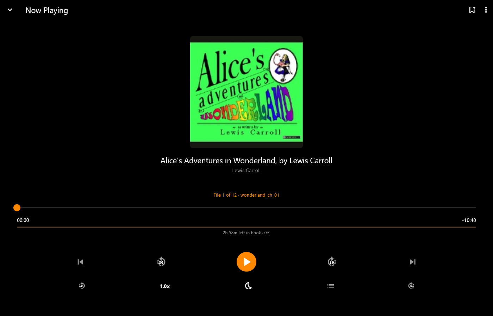
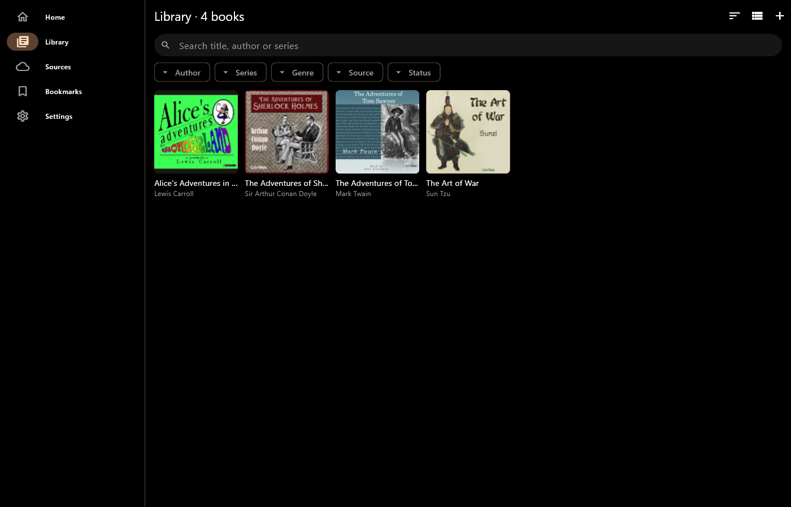
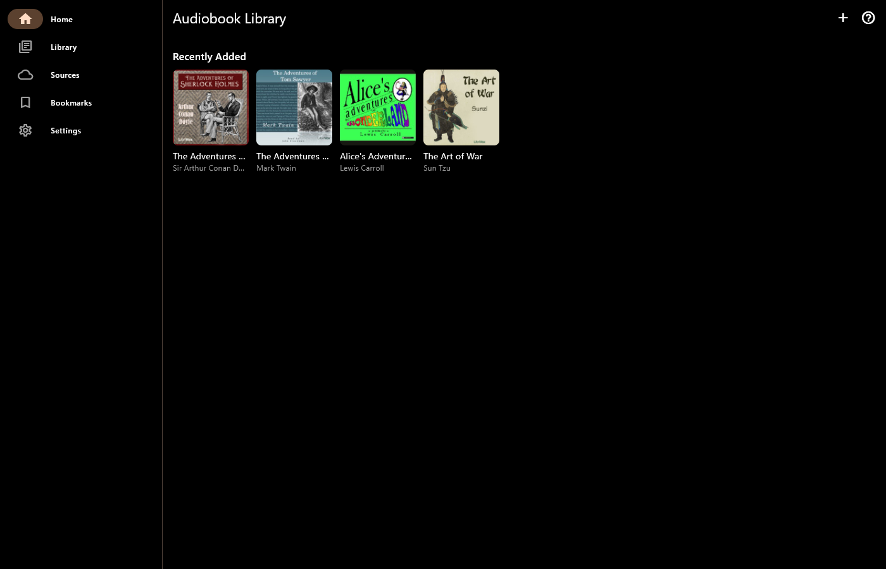
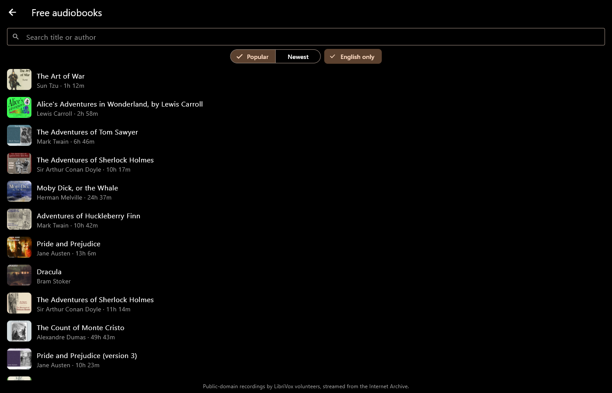
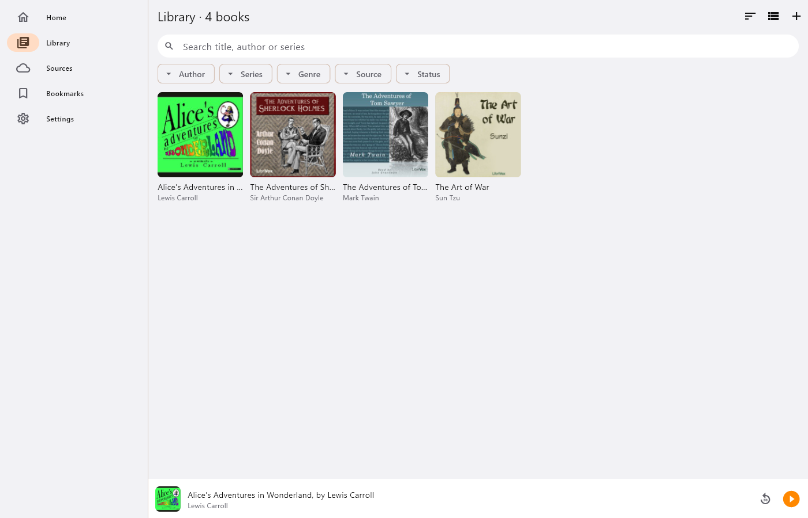

# Audiobook Library

**All your audiobooks in one place — streamed straight from your cloud.**

Audiobook Library brings together the audiobooks on your phone or PC and in
your OneDrive and Google Drive, and plays them without downloading whole
books first. Built for big collections: thousands of books, tens of
thousands of files. For Android and Windows.

## Get it

- **Windows:** [Microsoft Store](https://apps.microsoft.com/detail/9NTCNMVBPCNG) (listed as "Audiobook Library Player")
- **Android:** coming soon to Google Play

## Screenshots

Windows, with free LibriVox audiobooks.

## Your library, sorted for you

- Add a folder or connect OneDrive / Google Drive: books are found
  automatically. A folder of MP3s becomes one book, each M4B is a book, and
  CD and disc folders are merged
- Covers, titles, authors, narrators and chapters are read from your files,
  even in the cloud, without downloading the audio
- Search, and filter by author, series, source or listening status
- Continue listening, series in progress and recently added on the home
  screen
- Free audiobooks: browse and stream over 20,000 classics read by LibriVox
  volunteers, no account needed

## A player made for audiobooks

- Chapter-by-chapter seek bar, time left in the chapter and the book
- Speed from 0.75× to 3×, remembered per book
- Smart rewind, and undo a big jump with one tap
- Sleep timer by time or end of chapter, with a gentle fade-out
- Bookmarks with notes, even from the lock screen
- Background playback, lock-screen and headphone controls, Android Auto,
  and the Windows media keys

## Pro (one-off purchase)

- Download any book for offline listening: LibriVox, OneDrive and Google
  Drive
- Match book: narrator, series, description, cover and chapters found
  online
- Edit a book's details and cover by hand
- Save details, cover and chapters into your audio files, and upload them
  over the originals in your cloud storage

## Private by design

No account, no ads, no tracking. You sign in to Microsoft or Google on
their own pages, and your files are only changed when you ask.

[Privacy policy](privacy.html) · [Support](../support.html) ·
[All apps](../)
