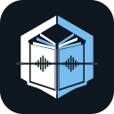

<a href="../entertainment/">Entertainment</a> › <a href="./">Audiobook Library</a> › Privacy policy

# Audiobook Library — Privacy Policy

*CJW Apps · Last updated 26 November 2026*

Audiobook Library is an audiobook player for Android and Windows. This
policy explains what the app does with your information. In short: **we
don't collect anything.** There is no account with us, no analytics, no
advertising and no server of ours that your data goes to.

## What stays on your device

Everything the app keeps is stored only on your phone or PC:

- your library: book titles, authors, narrators, covers, chapters and
  descriptions;
- listening progress, bookmarks and their notes, and your settings;
- audiobooks you download for offline listening;
- sign-in tokens for OneDrive and Google Drive, in your system's secure
  storage;
- a small diagnostic log, which never contains your sign-in tokens or
  download links. It stays on the device.

Uninstalling the app removes all of this.

## Your cloud storage (OneDrive, Google Drive)

If you connect OneDrive or Google Drive, you sign in on Microsoft's or
Google's own page; the app never sees your password. The app then:

- **reads** the folders you choose, to find audiobooks, read their tags and
  covers, and play them;
- **changes** your book files **only when you ask it to**: with **Update
  files** you can choose to save a book's details, cover and chapters back
  over its original files.
- with Pro's **Carry on from other devices** on, keeps one small file of
  your places in an **Apps › CJW Apps** folder in that account (see
  below).

Your files go straight between your device and Microsoft or Google; they
never pass through a server of ours. Microsoft's and Google's own privacy
policies apply to your storage with them. You can disconnect an account
in the app at any time, and remove the app's access in your Microsoft or
Google account settings.

Audiobook Library's use of information received from Google APIs adheres
to the [Google API Services User Data
Policy](https://developers.google.com/terms/api-services-user-data-policy),
including the Limited Use requirements.

## Carry on from other devices (Pro)

With Pro, Audiobook Library can keep your place in a book in step between your
devices. It is on once Pro is unlocked; you can turn it off in
**Settings › Pro › Carry on from other devices**.

**What is kept.** For each book: the book's cloud file ID (or, for a LibriVox book, its LibriVox ID; for a book from a folder on
your device, its total size and number of files),
its title, where you are in it, how far through it you are, whether it is
finished, when, and the name of the device (for example your computer's
name, which you can change) with a random ID made by the app. Nothing
else: no account details, no book contents.

**Where it is kept.** Only in storage you choose, never with us:

- books from OneDrive or Google Drive: a small file in the **Apps › CJW
  Apps** folder of that same account;
- LibriVox books and books from folders on your device (for example
  pCloud): only if you choose a cloud for them under **Keep their places
  in** (your OneDrive or Google Drive), in the same Apps › CJW Apps folder
  there. Otherwise their place stays on this device.

Each device writes only its own file and reads the others'. The files go
straight between your device and your storage; we run no servers and
never see them.

**Removing it.** **Remove this device's places** on the same Settings
page deletes this device's file. You can also delete the Apps › CJW Apps
folder at any time; the app makes a new one only if the feature is still
on.

## Services the app contacts

To do what you ask, the app makes ordinary web requests to these
services. They receive what any website receives (such as your IP
address) and the search words or book you asked about. They receive no
account or personal information from the app.

| Service | When |
|---|---|
| Microsoft (OneDrive) and Google (Google Drive) | When you connect them and use your audiobooks there |
| LibriVox, via the Internet Archive (archive.org) | When you browse, stream or download free audiobooks |
| Audible and Audnexus, Apple Books search, Google Books | When you use Match book to look up a book's details |

## Purchases

Audiobook Library Pro is a one-off purchase made through Google Play or
the Microsoft Store. The store handles the payment; we never see your
payment details. The app only learns whether Pro is unlocked.

On Android, the app uses Google Play's billing library to make the purchase
and to check whether Pro is already unlocked. Like Google's other code, it
sends Google its own diagnostic reports about how purchases are working
(for example errors and timings, and basic details of the phone and its
Android version). These go to Google under
[Google's privacy policy](https://policies.google.com/privacy), not to
us, and say nothing about your books. The Windows version uses the
Microsoft Store instead.

## Children

The app is not directed at children and collects no information from
anyone.

## Changes

If this policy changes, the new version will be posted here with a new
date.

## Contact

CJW Apps — [{{ site.email }}](mailto:{{ site.email }})
