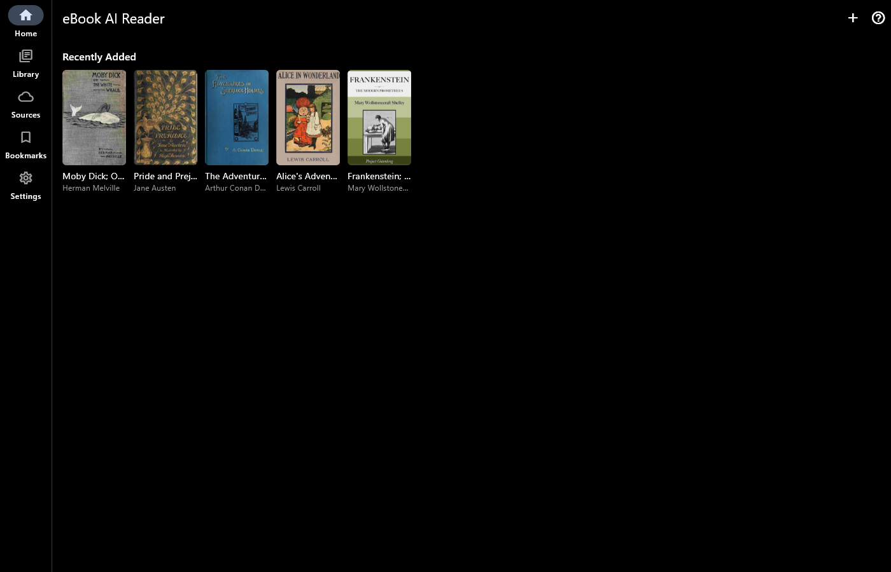
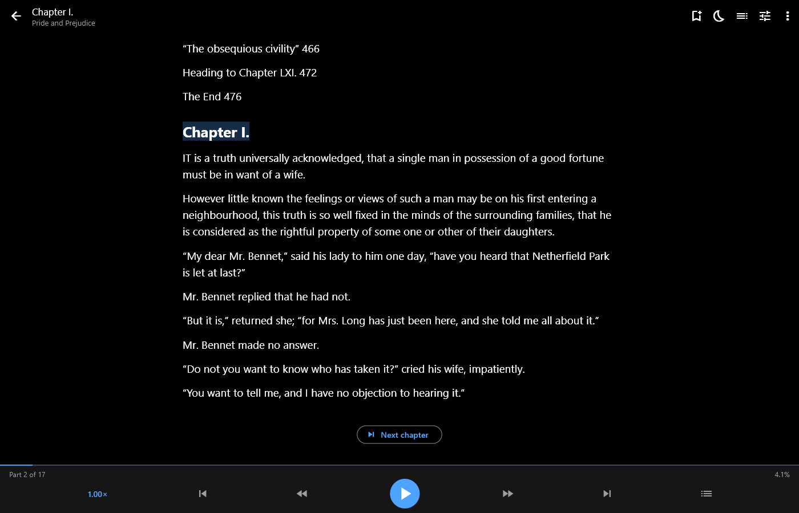
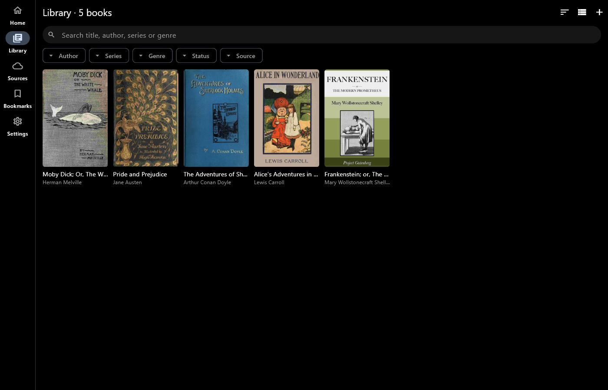
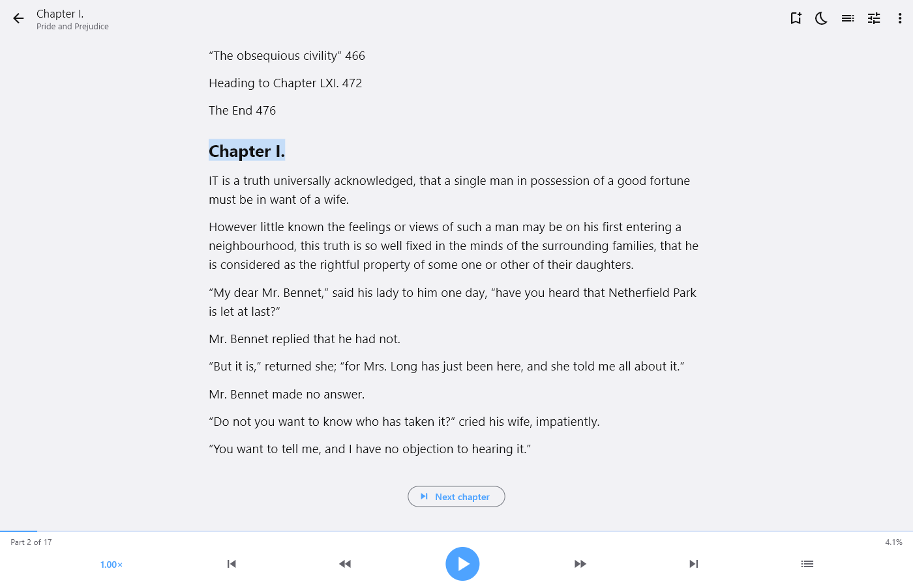
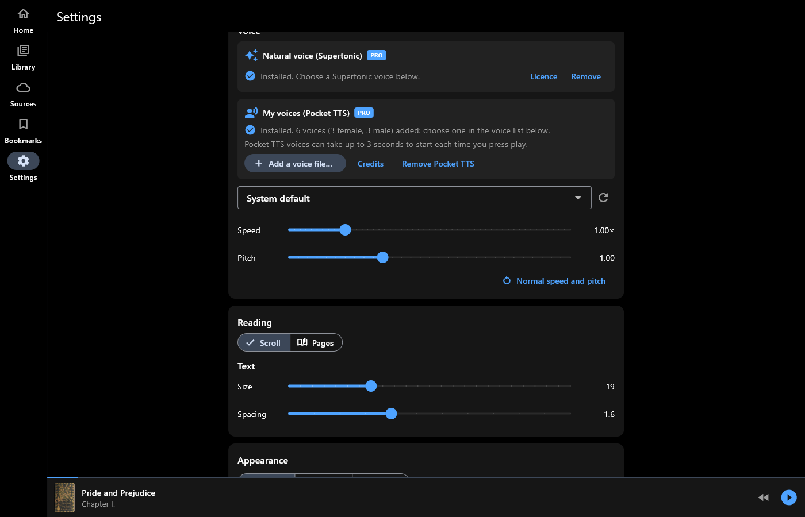
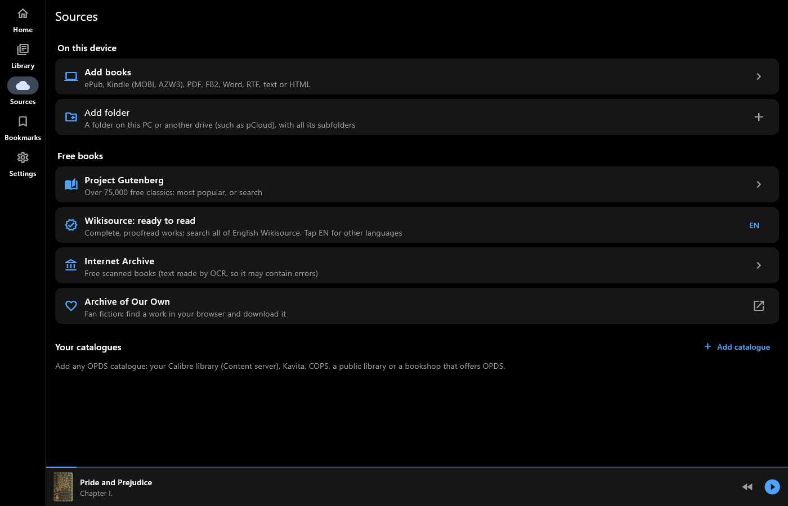

<a href="../entertainment/">Entertainment</a> › eBook AI Reader

# eBook AI Reader

**Read your ebooks, or listen to them.**

eBook AI Reader opens the books you already have and reads them aloud,
sentence by sentence, following along on the page. On your phone, in the
car and on your PC. For Android and Windows.

**Just want to read?** [eBook Library](../ebook-library/) is the lighter app: the same tidy library and reader,
without the read-aloud voices.

## Get it

- **Windows:** [Microsoft Store](https://apps.microsoft.com/detail/9NWL094R78JQ) (listed as "eBook AI Reader")
- **Android:** coming soon to Google Play

## Screenshots

Press a picture to see it full size.

Windows, with free classics from Project Gutenberg.

  <figure><figcaption>Home: recently added books</figcaption></figure>
  <figure><figcaption>Reading Pride and Prejudice, with the sentence being read highlighted</figcaption></figure>
  <figure><figcaption>The library, with search and filters</figcaption></figure>
  <figure><figcaption>The same book in the light theme</figcaption></figure>
  <figure><figcaption>Settings: the natural voice and My voices, with six included voices</figcaption></figure>
  <figure><figcaption>Sources: your files and folders, Project Gutenberg, Wikisource, the Internet Archive and your own catalogues</figcaption></figure>

## Every book you have

- ePub, Kindle (MOBI, AZW, AZW3, without DRM), PDF, FB2, Word (DOCX), RTF,
  text and HTML
- Add single books, whole folders (kept up to date), or books from
  OneDrive and Google Drive
- Open a book from your file manager or browser with "Open with"
- Free books: Project Gutenberg, Wikisource, the Internet Archive, and your
  own OPDS catalogues such as Calibre

## Read aloud

- Uses your device's voices, or natural voices (Pro) that run on your device,
  offline: the natural voice, and My voices, with six included English voices
  (UK, US and Australian, female and male) or ones you make yourself
- [Hear the six included voices](voices.html)
- Highlights the sentence being read
- Sleep timer, lock-screen and headphone controls
- Android Auto: listen to your books in the car

## A library that stays tidy

- Home: continue reading, series in progress, recently added
- Search and filter by author, series, genre, reading status and source
- Bookmarks with notes
- Scroll or turn pages, with your choice of text size and spacing

## Pro (one-off purchase)

- The natural voice and My voices
- Edit a book's details and cover, find details online, and edit several
  books together
- Save details back into your original files, on your device or in the
  cloud

## Private by design

No account, no ads, no tracking. You sign in to Microsoft or Google on
their own pages, and your books and reading stay on your device.

[Privacy policy](privacy.html) · [Support](../support.html) · [Contact](../contact.html) ·
[All apps](../)
