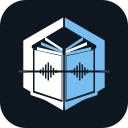

<a href="../entertainment/">Entertainment</a> › <a href="./">eBook AI Reader</a> › Privacy policy

# eBook AI Reader — Privacy Policy

*CJW Apps · Last updated 25 November 2026*

eBook AI Reader is an ebook reader for Android and Windows that can read
books aloud. This policy explains what the app does with your
information. In short: **we don't collect anything.** There is no account
with us, no analytics, no advertising and no server of ours that your
data goes to.

## What stays on your device

Everything the app keeps is stored only on your phone or PC:

- your books, their covers and details, and your library;
- reading positions, bookmarks and their notes, and your settings;
- the natural voice and My voices, if you download them, and any voice
  files you add to My voices;
- sign-in tokens for OneDrive and Google Drive, and passwords for any OPDS
  catalogues you add, in your system's secure storage;
- a small diagnostic log, which never contains sign-in tokens or
  passwords. It stays on the device.

Uninstalling the app removes all of this.

## Reading aloud

Reading aloud uses either your device's own speech engine (for example
Google's text-to-speech on Android, or the voices built into Windows) or
the natural voice or My voices, which run entirely on your device. The
text of your books is not sent anywhere by this app. My voices uses Pocket
TTS by Kyutai (voice model licensed CC BY 4.0), with six voices that come
with the app and any voice files you choose to add; voice files you add
stay on your device. Your device's speech engine is
provided by its maker, whose own policies apply.

## Your cloud storage (OneDrive, Google Drive)

If you connect OneDrive or Google Drive, you sign in on Microsoft's or
Google's own page; the app never sees your password. The app then:

- **reads** the files and folders you choose, to add those books to your
  library;
- **changes** your book files **only when you ask it to**: with **Update
  original file** you can choose to save a book's details and cover back
  into its file.
- with Pro's **Carry on from other devices** on, keeps one small file of
  your places in an **Apps › CJW Apps** folder in that account (see
  below).

Your files go straight between your device and Microsoft or Google; they
never pass through a server of ours. Microsoft's and Google's own privacy
policies apply to your storage with them. You can disconnect an account
in the app at any time, and remove the app's access in your Microsoft or
Google account settings.

eBook AI Reader's use of information received from Google APIs adheres to
the [Google API Services User Data
Policy](https://developers.google.com/terms/api-services-user-data-policy),
including the Limited Use requirements.

## Carry on from other devices (Pro)

With Pro, eBook AI Reader can keep your place in a book in step between your
devices, and between eBook Library and eBook AI Reader. It is on once Pro is unlocked; you can turn it off in
**Settings › Pro › Carry on from other devices**.

**What is kept.** For each book: the book's cloud file ID (or, for folder books, their file name and size),
its title, where you are in it, how far through it you are, whether it is
finished, when, and the name of the device (for example your computer's
name, which you can change) with a random ID made by the app. Nothing
else: no account details, no book contents.

**Where it is kept.** Only in storage you choose, never with us:

- books from OneDrive or Google Drive: a small file in the **Apps › CJW
  Apps** folder of that same account;
- books from folders on your device (matched by their file name and size): the **sync folder** you choose (for example a pCloud
  folder) and/or a **backup cloud** you choose (your OneDrive or Google
  Drive, the same Apps › CJW Apps folder).

Each device writes only its own file and reads the others'. The files go
straight between your device and your storage; we run no servers and
never see them.

**Removing it.** **Remove synced places** on the same Settings page
deletes this device's file. You can also delete the Apps › CJW Apps folder
or the files in your sync folder at any time; the app makes a new one only
if the feature is still on.

## Services the app contacts

To do what you ask, the app makes ordinary web requests to these
services. They receive what any website receives (such as your IP
address) and the search words or book you asked about. They receive no
account or personal information from the app.

| Service | When |
|---|---|
| Microsoft (OneDrive) and Google (Google Drive) | When you connect them and add or update books there |
| Project Gutenberg and Gutendex, Wikisource, the Internet Archive | When you browse, search or download free books |
| OPDS catalogues you add yourself | When you open them; your user name and password go only to that catalogue |
| Apple Books search, Open Library | When you use Find details online |
| Hugging Face (huggingface.co) | Once for each, when you download the natural voice or My voices (Pocket TTS) |
| Archive of Our Own | Opened in your web browser when you choose it |

## Purchases

eBook AI Reader Pro is a one-off purchase made through Google Play or the
Microsoft Store. The store handles the payment; we never see your payment
details. The app only learns whether Pro is unlocked.

## Children

The app is not directed at children and collects no information from
anyone.

## Changes

If this policy changes, the new version will be posted here with a new
date.

## Contact

CJW Apps — [{{ site.email }}](mailto:{{ site.email }})
