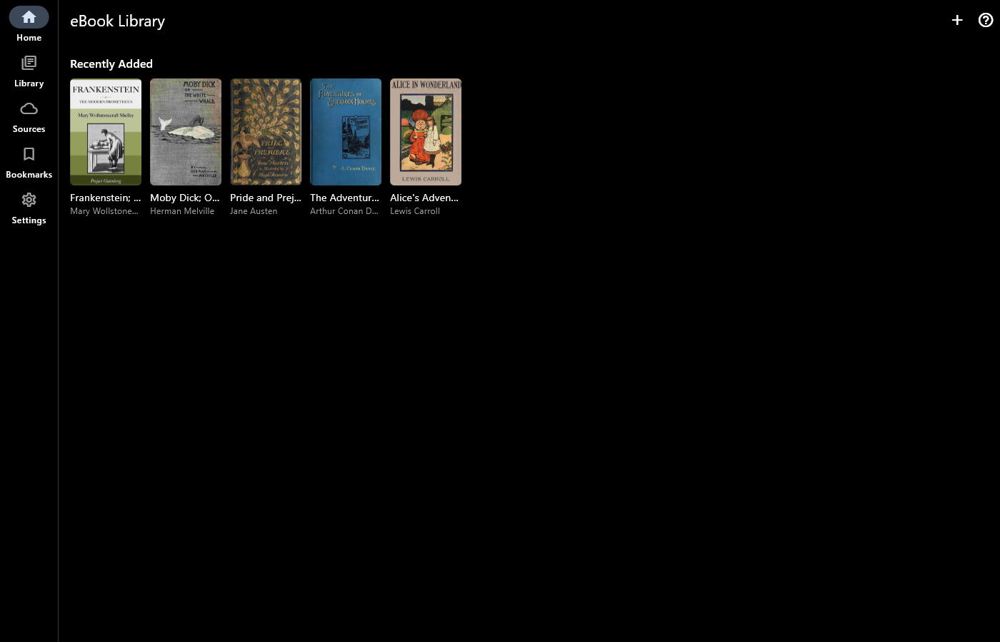
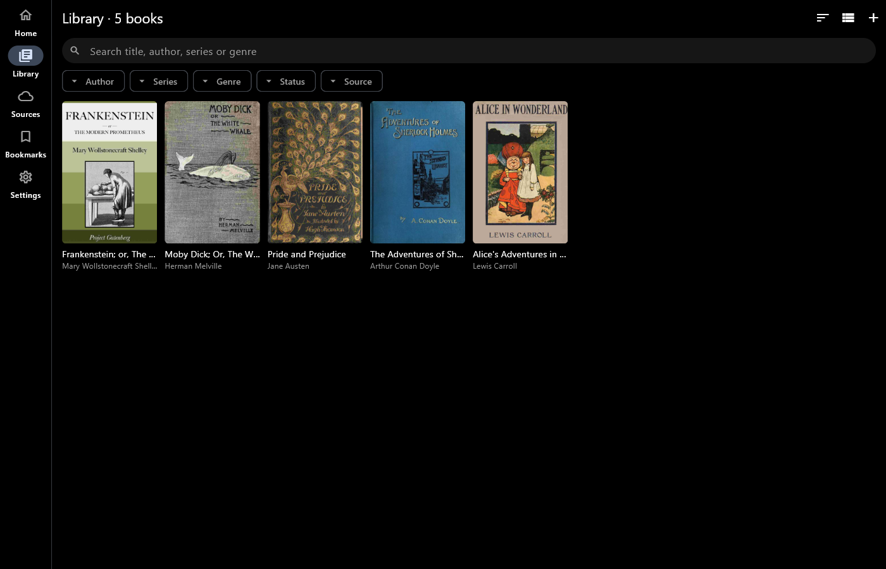
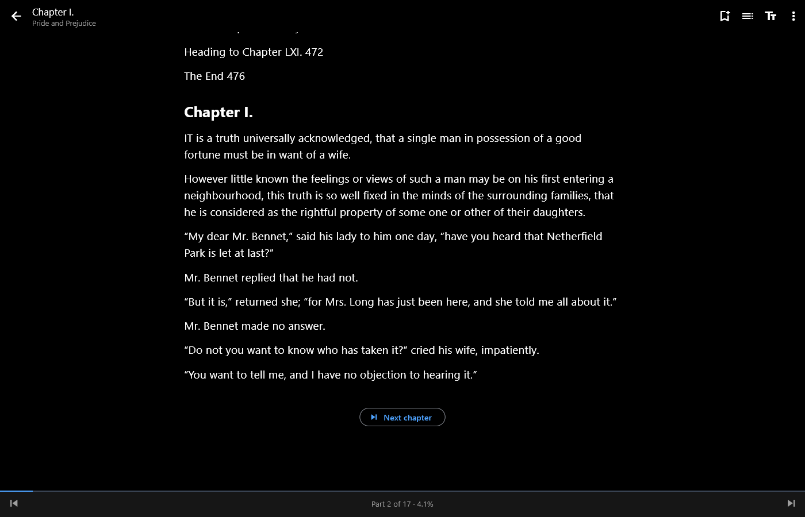
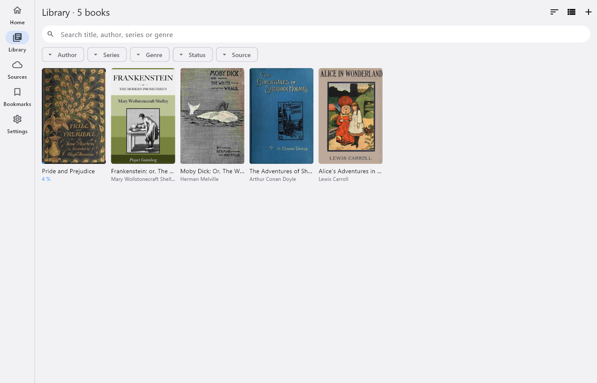
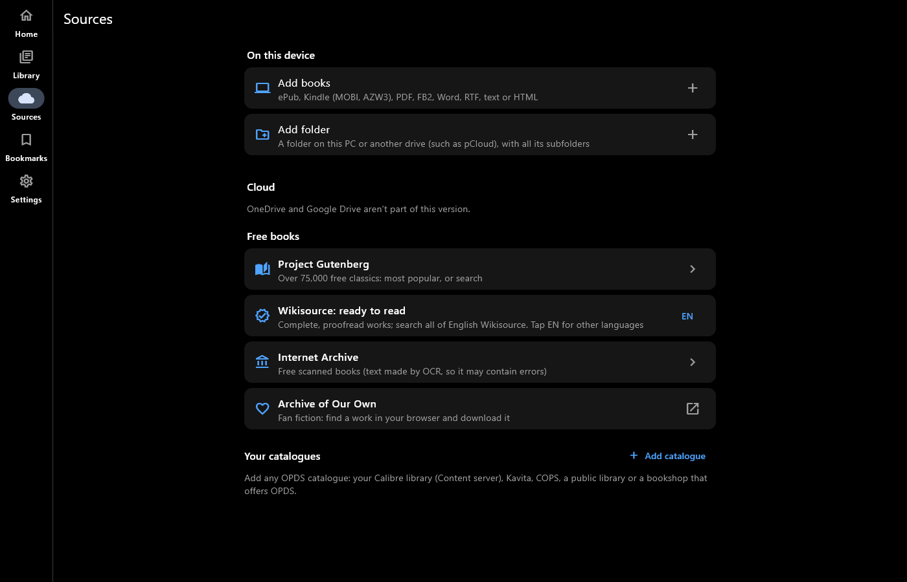

# eBook Library

**All your ebooks in one tidy library.**

eBook Library gathers the ebooks on your device and in your cloud storage
into one library, with covers, series and details, and a comfortable
reader. For Android and Windows.

## Get it

- **Windows:** [Microsoft Store](https://apps.microsoft.com/detail/9P23H7S4TF02) (listed as "eBook Library Bookshelf")
- **Android:** coming soon to Google Play

## Screenshots

Windows, with free classics from Project Gutenberg.

## Every book you have

- ePub, Kindle (MOBI, AZW, AZW3, without DRM), PDF, FB2, Word (DOCX), RTF,
  text and HTML
- Add single books, whole folders (kept up to date), or books from
  OneDrive and Google Drive
- Open a book from your file manager or browser with "Open with"
- Free books: Project Gutenberg, Wikisource, the Internet Archive, and your
  own OPDS catalogues such as Calibre

## A library that stays tidy

- Home: continue reading, series in progress, recently added
- Search and filter by author, series, genre, reading status and source
- Series in order
- Bookmarks with notes
- Scroll or turn pages, with your choice of text size and spacing

## Pro (one-off purchase)

- Edit a book's details and cover
- Find details online for one book or many, and edit several books
  together
- Save details back into your original files, on your device or in the
  cloud

## Private by design

No account, no ads, no tracking. You sign in to Microsoft or Google on
their own pages, and your books and reading stay on your device.

[Privacy policy](privacy.html) · [Support](../support.html) ·
[All apps](../)
