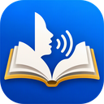
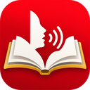

  
Entertainment

  <h1>Apps for people with a lot of books</h1>
  
On Android and Windows. No accounts, no ads, no tracking: your library stays on your device.

  

    

      
      

        <h2><a href="../audiobook-library/">Audiobook Library</a></h2>
        
Android · Windows

      

    

    
All your audiobooks in one place, streamed straight from OneDrive, Google Drive or your device, with a player made for audiobooks.

    

      <a class="btn" href="https://apps.microsoft.com/detail/9NTCNMVBPCNG">Microsoft Store</a>
      Google Play: coming soon
    

    

      <a class="btn ghost" href="../audiobook-library/">More about it</a>
      <a class="btn ghost" href="../audiobook-library/privacy.html">Privacy policy</a>
    

  

  

    

      
      

        <h2><a href="../ebook-ai-reader/">eBook AI Reader</a></h2>
        
Android · Windows

      

    

    
Read your ebooks, or have them read aloud: ePub, Kindle, PDF and more, with natural voices, including six of our own, that run offline.

    

      <a class="btn" href="https://apps.microsoft.com/detail/9NWL094R78JQ">Microsoft Store</a>
      Google Play: coming soon
    

    

      <a class="btn ghost" href="../ebook-ai-reader/">More about it</a>
      <a class="btn ghost" href="../ebook-ai-reader/voices.html">Hear the voices</a>
      <a class="btn ghost" href="../ebook-ai-reader/privacy.html">Privacy policy</a>
    

  

  

    

      
      

        <h2><a href="../ebook-library/">eBook Library</a></h2>
        
Android · Windows

      

    

    
All your ebooks in one tidy library, with covers, series and a comfortable reader.

    

      <a class="btn" href="https://apps.microsoft.com/detail/9P23H7S4TF02">Microsoft Store</a>
      Google Play: coming soon
    

    

      <a class="btn ghost" href="../ebook-library/">More about it</a>
      <a class="btn ghost" href="../ebook-library/privacy.html">Privacy policy</a>
    

  

## How the apps use Google Drive

If you choose to connect Google Drive, the apps ask for access to your Drive
so you can use the audiobooks and ebooks you keep there:

- **Reading:** the apps list the folders you browse and read the files you
  add, so they can show covers and details, and play or open your books.
- **Writing:** only when you ask, the apps save a book's details back into its
  original file (and, for audiobooks, its cover and chapters).

Your files go straight between your device and Google. They never pass through
a server of ours, and they aren't used for advertising, sold or shared. You can
disconnect in the app at any time, or remove CJW Apps' access in your Google
Account. See the [privacy policy](../privacy.html).

