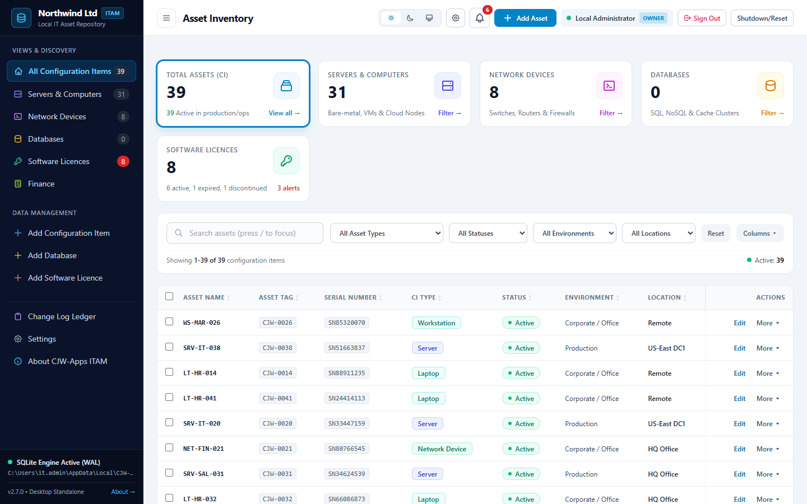
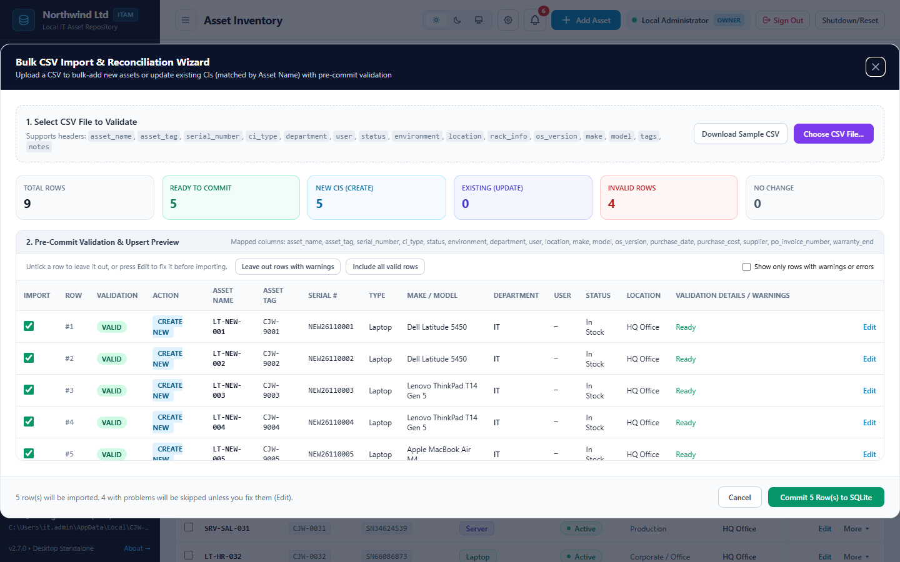
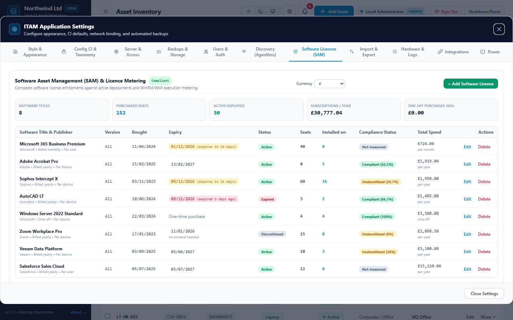
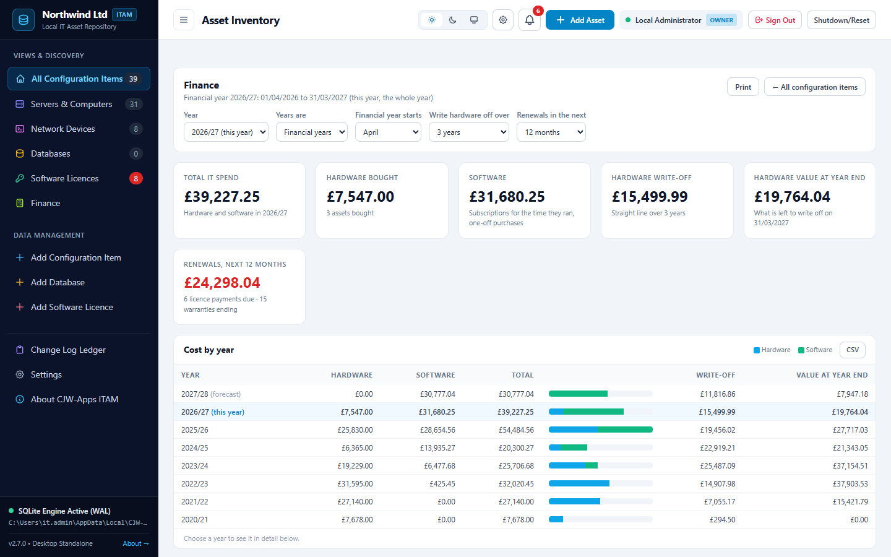

<a href="../business/">Business</a> › CJW-Apps ITAM

# CJW-Apps ITAM

IT Asset Management that stays on your own PC. A register of your
hardware and software licences on **Windows**. No account with us, no
cloud of ours: your inventory is stored locally.

**Two versions:** the [Microsoft Store version](#microsoft-store-version)
for starters and small businesses, and the [Download version](#download-version)
for SMEs, schools and school trusts.

**Editions and prices:** [Microsoft Store version](store/) ·
[Download version](download/)

**Guides:** [Microsoft Store version](guides/) ·
[Download version](download/guides/)

  <figure><figcaption>The dashboard</figcaption></figure>
  <figure><figcaption>Every import is reviewed first</figcaption></figure>
  <figure><figcaption>Software licences and compliance</figcaption></figure>
  <figure><figcaption>Finance: spend and forecast</figcaption></figure>

Press a picture to see it full size.

  
<strong>Every import is reviewed first</strong>
Network scans, CSV files, Intune and Google Workspace: you see what would be added or changed before anything is saved.

  
<strong>Nothing is deleted or locked</strong>
If Pro or a licence key ends, ITAM goes back to the free version. All your data stays viewable and exportable.

  
<strong>Your data stays on your PC</strong>
No account with us and no cloud of ours. Back it up to any folder you choose.

## Which version?

| | Microsoft Store version | Download version |
|---|---|---|
| **For** | Starters and small businesses | SMEs, schools and school trusts |
| **Install** | From the Microsoft Store, in a minute | By your IT team: on one PC, or as a Windows service on a server |
| **Updates** | Automatic, through the Store | You choose when to install them |
| **Paying** | Monthly or yearly, through your Microsoft account | A yearly licence key, with an invoice |
| **Free** | Up to 100 assets | Up to 100 assets |
| **Trial** | 30 days of ITAM Pro | A free 30-day key, on request |
| **Schools** | One organisation | One school, or a trust with several schools |
| **Available** | [Now](https://apps.microsoft.com/detail/9N828LN3WS8V) | Early access: [request a trial](mailto:{{ site.email }}?subject=ITAM%20Download%20version%3A%20trial%20request) or join the schools pilot |

## Microsoft Store version

For starters and small businesses: install it from the Microsoft Store and
start straight away. Free for up to 100 assets; ITAM Pro removes the limit
and adds Microsoft Intune and Google Workspace device imports, from £44.99
a month with a 30-day free trial.

<a class="btn" href="https://apps.microsoft.com/detail/9N828LN3WS8V">Get it from the Microsoft Store</a>
<a class="btn ghost" href="store/">Editions and prices</a>
<a class="btn ghost" href="guides/">Guides</a>

## Download version

For SMEs, schools and school trusts, and for organisations where the
Microsoft Store is blocked. Your IT team installs it on one PC, or as a
Windows service on a server. Free for up to 100 assets without a key;
the Pro, Education and Education Trust editions are a yearly licence key.
**Early access:** the schools pilot is open, and SMEs can ask for a
30-day trial key.

<a class="btn" href="mailto:{{ site.email }}?subject=ITAM%20Download%20version%3A%20trial%20request">Request a trial</a>
<a class="btn ghost" href="download/">Editions and prices</a>
<a class="btn ghost" href="download/guides/">Guides</a>

## Know what you have

- One record per asset: name, tag, serial number, type, user,
  department, location, status, make, model and OS.
- Purchase date, cost, supplier, PO / invoice number and warranty end,
  with a warning before a warranty runs out.
- Hardware lifecycle: end-of-life and end-of-support dates.
- Search, filters and CSV import and export.

## Find it automatically

- Agentless network discovery (ping, WMI, SSH, SNMP): nothing to
  install on the devices.
- Microsoft Intune and Google Workspace device imports (ITAM Pro), on demand or on
  a schedule.
- Every import is reviewed first: you see what would be added or
  changed before anything is saved.

## Software licences

- Seats bought and the assets each licence is installed on, with
  compliance at a glance.
- Subscriptions and one-off purchases, renewal dates and yearly costs.
- Alerts before a licence expires.

## Built for a team

- Viewer, editor and administrator roles; sign in with a local account,
  Microsoft or Google.
- Share it with colleagues on your network over HTTPS.
- A change log, automatic sign-out and scheduled backups.

[Microsoft Store version](store/) · [Download version](download/) · [Privacy policy](privacy.html) · [Support](../support.html) · [Contact](../contact.html) · [Business apps](../business/) · [All CJW Apps](../)
